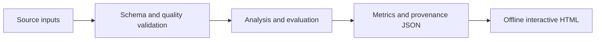

# Architecture and engineering decisions

**Project flow:** Hourly counts + GHCN station file --> quality gates --> daily one-to-one join --> chronological validation --> benchmark + interactive report.

## Design decisions

### Coverage before estimation
A day with 23 observed hours is not comparable to a day with 24. The pipeline excludes it rather than inventing a zero or estimating missing rentals. This makes the cohort smaller but the daily units explicit.

### Time-aware evaluation
The final 20% of eligible dates are held out. Three earlier expanding-window folds use only the training period. Hyperparameters are fixed; no settings are selected on the final holdout. A seven-day baseline looks up the actual date seven calendar days earlier, rather than shifting seven retained rows.

### Baselines and regime sensitivity
Calendar-only and calendar-plus-weather models share the estimator family and settings. The weather model leads in the final period but not every earlier fold, which separates a measured result from a claim of universal superiority.

## Failure behavior

Schema errors, invalid analysis inputs and insufficient cohorts fail with an explicit command-line error and a nonzero exit status. Results serialize as strict JSON; non-finite values cannot silently enter the report. The HTML renderer escapes embedded JSON and writes chart labels as text. Reports make no external script, analytics or data requests.

## Source layout

- `src/mobility_weather/` contains the implementation and report renderer.
- `tests/` covers data/model invariants and report consistency.
- `docs/` contains a generated real-data report and its machine-readable results.
- `.github/workflows/ci.yml` runs checks on Python 3.11 and 3.12.

## Public artifacts

Raw restricted datasets are never embedded in the reports. Public outputs contain analytical aggregates and source fingerprints. Input filenames appear in the reproducibility record; local directories do not. Source/provider terms are documented separately in `DATA.md`.
