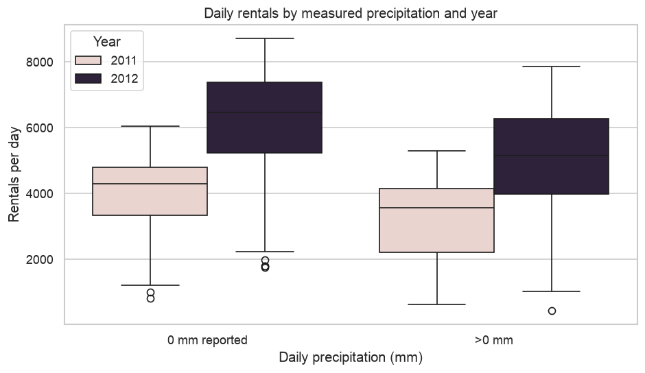

# Bike-Share Demand & Weather

How does weather relate to bike-share demand—and how much can incomplete data distort the answer? This project combines hourly rental records with daily weather observations to build a validated dataset for demand analysis.

**Python · pandas · NumPy · Matplotlib · seaborn · requests**



## Results

| Finding | Result |
|---|---|
| Missing date/hour slots identified | 165 across 76 dates |
| Median rentals on precipitation days, relative to zero-reported days | 17.3% lower in 2011; 20.4% lower in 2012 |
| Rental coverage for the main comparison | Dates with all 24 coded hours |

## Implementation

- Integrated UCI Capital Bikeshare counts with NOAA station observations using two different acquisition methods.
- Decoded weather missing-value and quality flags, reshaped monthly records into daily observations, and aligned units before joining sources.
- Built validation checks for duplicate keys, hour coverage, rental totals and temperature consistency.
- Separated raw inputs, cleaned tables and figures, with a source manifest for traceability.

## Practical relevance

Demonstrates the data preparation and validation work behind operational reporting, demand analysis and forecasting pipelines. The weather comparisons provide questions to investigate when planning fleet availability.

## Explore the project

- `bikeshare_weather.ipynb` — acquisition, assessment, cleaning, validation and analysis.
- `raw/uci_bikeshare_hourly.csv` — attributed hourly input.
- `DATA.md` — source details and input requirements.

## Run locally

```sh
python -m venv .venv
. .venv/bin/activate
python -m pip install -r requirements.txt
jupyter lab
```

Open `bikeshare_weather.ipynb` from the repository root and run the cells in order. The first run downloads the NOAA station file. Output tables and charts are written to `cleaned/` and `figures/`.

See [DATA.md](DATA.md) for required inputs and [VALIDATION.md](VALIDATION.md) for the checks and runtime versions.

## Scope

The results describe associations. Airport weather is a regional proxy; season, working days and system growth can affect demand. Missing hourly records are not treated as zero rentals.

---

**Feras Elghandour** · [GitHub](https://github.com/FerasElghandour)
