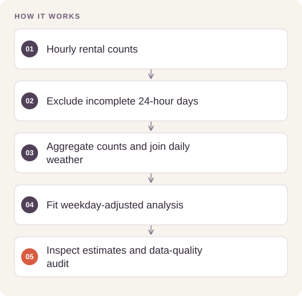
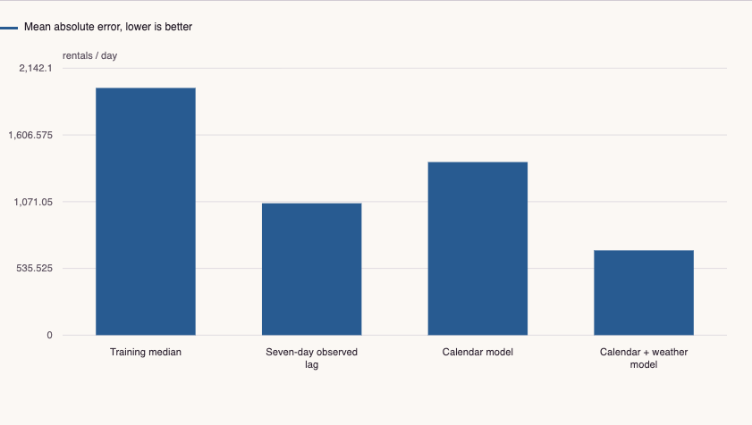

# Weather-Aware Bike-Share Demand Analysis

A quality-gated data pipeline and chronological modelling benchmark that connects hourly rental counts with daily weather observations.

**[Open the interactive report](https://feraselghandour.github.io/bikeshare-weather-analysis/)** · [Architecture](ARCHITECTURE.md) · [Methods and validation](VALIDATION.md)

[](https://github.com/FerasElghandour/bikeshare-weather-analysis/actions/workflows/ci.yml)

## How it works




## Reproduce and inspect

The executable reproduction profile now records exact commands, input/source hashes, dependency versions, logs and pass/fail status. Its scope distinguishes behavior checks from full-data benchmarks.

[Commands, artifacts and benchmark scope](BENCHMARKS.md) · [Versioned profiles](reproduction.json)


## Try a small example

A small offline fixture exercises the public implementation. It demonstrates the behavior shown below; it does not replace the historical dataset, benchmark or production validation.

After the local setup below, run from the repository root:

```sh
python examples/quickstart.py
```

The [example source](examples/quickstart.py), [captured output](examples/expected-output.txt) and [execution record](examples/environment.json) keep this demonstration inspectable. Floating-point values may vary with library versions.

Observed output from this run:

```text
{
  "fixture": "generated two days with one missing hour",
  "audit": {
    "hourly_rows": 47,
    "calendar_days": 2,
    "missing_hour_slots": 1,
    "complete_hour_days": 1,
    "weather_incomplete_days": 0,
    "analysis_days": 1
  },
  "retained_daily_rentals": [
    72
  ]
}
```

## What the evidence shows

The calendar-and-weather model reduces final-holdout mean absolute error by **35.7%** relative to a seven-day observed-lag baseline. Earlier expanding-window validation also exposes a period where the lag baseline performs better.

| Measure | Result |
|---|---|
| Final holdout | 122 dates, August 21–December 30, 2012 |
| Calendar + weather MAE | 680.4 rentals/day |
| Seven-day observed-lag MAE | 1,058.2 rentals/day |
| Calendar-only MAE | 1,388.9 rentals/day |
| Quality gate | 165 absent date/hour slots identified before aggregation |

The interactive report includes selectable comparisons, a matching numerical table, CSV/JSON downloads and the reproducibility record. It also works offline: download `docs/index.html` and open it in a browser.

[](https://feraselghandour.github.io/bikeshare-weather-analysis/)

## Engineering

- Validated fixed-width weather ingestion, missing-value decoding and quality-flag handling.
- Unique-key and count-identity checks before the daily join; incomplete-hour dates excluded explicitly.
- Four baselines evaluated on identical dates, plus three expanding-window validation folds inside the training period.
- A downloadable results record with input and source-code fingerprints, estimator settings and dependency versions.

The analysis is packaged under `src/mobility_weather/`; notebooks remain available for the longer exploratory narrative. Small root-level entry points preserve existing commands.

## Reproduce

Use Python 3.11 or later and a separate virtual environment for this repository.

```sh
python -m venv .venv
. .venv/bin/activate
python -m pip install -e ".[dev]"
python -m mobility_weather --rentals raw/uci_bikeshare_hourly.csv --weather /path/to/USW00013743.dly --output reports
python -m pytest -q
```

The attributed rental CSV is included. Obtain the NOAA station file using the source link in [DATA.md](DATA.md). The CLI takes an explicit local snapshot, so it never silently changes the weather source during a run.

Each run writes `index.html` and `metrics.json` to the chosen output directory. The JSON records the measured results, input SHA-256 fingerprints, source-code fingerprints, dependency versions and analytical settings. To use the notebooks, install the optional `notebooks` dependencies.

## Interpretation

This estimates historical demand using contemporaneous observed weather. It is not a forecast using predicted future weather. The weather model loses to the seven-day baseline in one of three earlier validation periods. That finding argues for monitoring regime changes before deploying a demand model.

## Portfolio

- [Bike-Share Customer Behavior](https://github.com/FerasElghandour/bikeshare-customer-behavior)
- [Movie Revenue: Selection, Sensitivity & Uncertainty](https://github.com/FerasElghandour/movie-revenue-analysis)
- [Shared-Policy Continuous Control](https://github.com/FerasElghandour/tennis-reinforcement-learning)

---

**Feras Elghandour** · [GitHub](https://github.com/FerasElghandour)  
Data sources and applicable license notices: [DATA.md](DATA.md).
